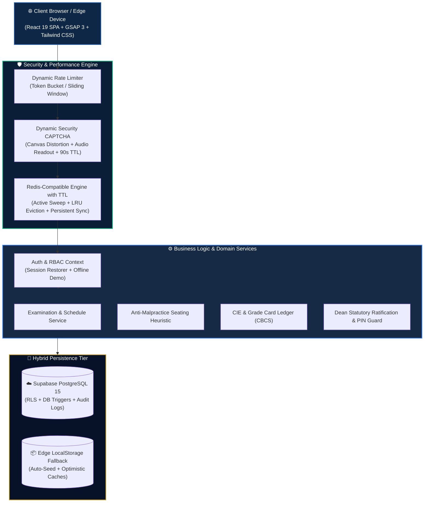
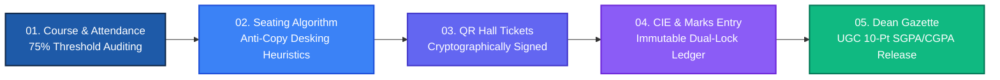

<div align="center">

# 🏛️ UEAMS &bull; University Examination & Academic Management System
### *Enterprise Digital Backbone for Statutory University Examination Governance*

[](https://sivangni-ueams.vercel.app)
[](https://github.com/Shivanginichauhan/clg_minor_project)
[](https://gsap.com)
[](https://redis.io)
[](#-security-architecture)

<p align="center">
  
  
  
  
  
  
  
  
  
</p>

<p align="center">
  <b>Eliminating disjointed spreadsheets and paperwork through automated 75% attendance safeguarding, heuristic anti-malpractice seating layouts, QR-signed admit cards, Continuous Internal Evaluation (CIE) locking, and Dean-authorized gazette publication.</b>
</p>

---

[🌐 Explore Live Application](https://sivangni-ueams.vercel.app) &bull;
[✨ System Design](#-system-design--architecture) &bull;
[⚡ Redis & Rate Limiting](#-redis-ttl-engine--rate-limiting) &bull;
[👥 Stakeholder Portals](#-role-based-portals) &bull;
[🔄 Examination Lifecycle](#-5-stage-examination-lifecycle) &bull;
[🔑 Demo Credentials](#-instant-demo-credentials) &bull;
[📖 Detailed Presentation Guide](PROJECT_ARCHITECTURE_PRESENTATION_GUIDE.md)

---

</div>

<br />

## 🌟 Key Architectural Innovations

```
┌──────────────────────────────────────────────────────────────────────────────┐
│  ✨ Precision Examination Governance • Designed for High-Integrity Academics │
└──────────────────────────────────────────────────────────────────────────────┘
```

- **⚡ Redis-Compatible In-Memory Engine with TTL**: Universal edge & client-side key-value cache engine supporting `GET`, `SET`, `SETEX`, `DEL`, `EXPIRE`, `TTL`, `INCR`, `HSET`, `HGETALL`, `LPUSH`, and `LRANGE` with active 10s background sweeps, passive lookup eviction, and LRU memory capping.
- **🛡️ Enterprise Dynamic Rate Limiting**: Token Bucket & Sliding Window Log algorithm enforcing dynamic attempt caps per route (`auth:login`, `auth:signup`, `auth:forgot-password`, `dean:statutory-pin`, `academic:revaluation`) with automated lockouts, visual countdown timers, and attempt indicator dots.
- **🧩 Dynamic Multi-Mode Security CAPTCHA**: HTML5 canvas rendering distorted 5-character alphanumeric strings with randomized rotational angles, sinusoidal wave distortion, noise dots, and bezier distraction curves — coupled with an accessible Web Speech API audio readout and 90-second Redis TTL auto-expiry.
- **🛡️ 75% Attendance Safeguarding Engine**: Automated continuous auditing of classroom lecture registers with proactive condonation alerts (65–75%) and automatic admit card withhold triggers (<65%).
- **🪑 Anti-Malpractice Seating Algorithm**: Heuristic classroom layout allocator ensuring adjacent students never belong to the same cohort or receive the same question paper variant.
- **🎫 Cryptographic Digital Hall Tickets**: One-click generation of Dean-signed admit cards featuring dynamically encoded verification tokens and QR authenticity validation.
- **🔒 Tamper-Proof Marks Ledger**: Multi-tiered Continuous Internal Evaluation (CIE) & End-Semester score entry system with timestamped freeze deadlines and immutable Supabase audit logging.
- **📜 Dean Gazette & Transcript Engine**: Statutory moderation curves, SGPA/CGPA normalization under the UGC-CBCS 10-point scale, and authorized e-tabulation registry publishing.
- **☁️ 100% Serverless Resilience**: Dual-mode hybrid persistence combining Supabase cloud queries with immediate local store fallbacks, allowing the full suite to run offline and serverlessly on Vercel edge networks.

---

## 🏗️ System Design & Architecture



---

## ⚡ Redis TTL Engine & Rate Limiting

The application embeds an in-memory Redis implementation (`src/lib/redisCache.ts`) mimicking core Redis operations:

### 1. Redis Core Commands API
```typescript
import { redis } from './lib/redisCache';

// String Operations with Time-To-Live (TTL)
redis.setex('session:student:101', 3600, { role: 'student', active: true });
const session = redis.get('session:student:101');
const ttlSeconds = redis.ttl('session:student:101'); // Returns remaining TTL in seconds

// Atomic Counter Operations
const currentAttempts = redis.incr('ratelimit:attempts:auth:login:127_0_0_1');
redis.expire('ratelimit:attempts:auth:login:127_0_0_1', 60); // 60s sliding window

// Hash Storage
redis.hset('student:grades', 'CS101', { internal: 38, external: 54 });
const grade = redis.hget('student:grades', 'CS101');
```

### 2. Rate Limiting Policy Matrix
| Target Endpoint | Max Attempts | Window Duration | Penalty Lockout | Strategy |
|:---|:---:|:---:|:---:|:---|
| **Sign In Authentication** (`auth:login`) | **5** | 60 seconds | **300 seconds (5 min)** | Token Bucket + Canvas CAPTCHA |
| **Account Self-Registration** (`auth:signup`) | **3** | 120 seconds | **600 seconds (10 min)** | Sliding Window + Canvas CAPTCHA |
| **Password Reset Dispatch** (`auth:forgot-password`) | **3** | 180 seconds | **300 seconds (5 min)** | Sliding Window + Canvas CAPTCHA |
| **Dean Statutory PIN** (`dean:statutory-pin`) | **3** | 180 seconds | **300 seconds (5 min)** | Atomic Lockout + Audit Log |
| **Revaluation Filing** (`academic:revaluation`) | **2** | 60 seconds | **120 seconds (2 min)** | Submission Rate Guard |

---

## 👥 Role-Based Portals

The application implements granular **Row-Level Security (RLS)** in Supabase to provide bespoke digital workspaces tailored for each university stakeholder:

| Portal | Primary Beneficiaries | Core Capabilities & Workflows |
|:---|:---|:---|
| 🎓 **Student Portal** | Students, Candidates, Alumni | Attendance register tracker, syllabus milestones, digital admit card download, SGPA/CGPA grade sheets, fee clearance verification, and online revaluation filing. |
| 👨‍🏫 **Faculty Portal** | Professors, Lecturers, Evaluators | One-click daily lecture attendance marking, CIE internal marks lockable sheets, syllabus milestone registers, invigilation duty schedules, and CO-PO attainment evidence. |
| 🏛️ **Controller & Admin** | Examination Cell, Registrars | Academic structure configuration (Departments, Curriculums, Sessions), anti-cheating room layout generator, datesheet builder, fee structures, and audit trail analysis. |
| 📜 **Dean & Executive** | Deans, Vice-Chancellor, Academic Council | Statutory datesheet sign-offs, grade curve moderation, institution-wide pass/fail performance analytics, and official university gazette cryptographic sealing. |

---

## 🔄 5-Stage Examination Lifecycle



---

## 🔑 Instant Demo Credentials

Try any persona instantly with one click on the [Sign In Page](https://sivangni-ueams.vercel.app/login) using the built-in quick fill buttons, or enter the credentials below:

```
Common Password for all demo accounts: Password123!
```

| Persona | Role | Email | Access Scope |
|:---|:---|:---|:---|
| 🎓 **Student** | `student` | `student@university.edu` | View Hall Ticket, SGPA/CGPA, 89.4% Attendance |
| 👨‍🏫 **Faculty** | `faculty` | `faculty@university.edu` | Grade Book, Lecture Attendance, Invigilation Roster |
| 🛡️ **Administrator** | `administrator` | `admin@university.edu` | Seating Allocations, Curriculums, Timetables, Audits |
| 👑 **Dean** | `dean` | `dean@university.edu` | Gazette Sign-Off, Normalization, Analytics |

---

## 🛠️ Tech Architecture

<div align="center">

| Layer | Technologies |
|:---|:---|
| **Core Framework** | **React 19**, TypeScript 5, Vite 6 |
| **Animation Engine** | **GreenSock (GSAP 3)**, `@gsap/react`, ScrollTrigger, Custom Eases |
| **Cache & Rate Limiting** | **In-Memory Redis Engine with TTL**, Token Bucket Sliding Window, HTML5 Canvas CAPTCHA |
| **Styling & Design** | **Tailwind CSS 3**, CSS Variables, Dark/Light Theming, Lucide Icons |
| **Data & Routing** | **React Router v7**, Recharts (Data Visualizations) |
| **Backend & Database** | **Supabase** (PostgreSQL 15, Row-Level Security, JWT Auth, Triggers) |
| **Deployment** | **Vercel** with custom SPA rewrites (`vercel.json`) & GitHub Actions |

</div>

---

## 🚀 Getting Started

Follow these steps to run the complete environment locally:

### 1. Clone the Repository
```bash
git clone https://github.com/Shivanginichauhan/clg_minor_project.git
cd clg_minor_project
```

### 2. Install Dependencies
```bash
npm install
```

### 3. Setup Environment Variables
Create a `.env` file in the project root:
```env
VITE_SUPABASE_URL="https://your-project.supabase.co"
VITE_SUPABASE_ANON_KEY="your-anon-public-key"
```

### 4. Launch Development Server
```bash
npm run dev
```
Open your browser and navigate to: **`http://localhost:3000`**

### 5. Production Compilation & Verification
```bash
# Typecheck
npm run lint

# Compile production bundle
npm run build

# Preview production build locally
npm run preview
```

---

## 📂 Project Architecture

```
clg_minor_project/
├── public/                 # Static assets, fonts and favicon
├── src/
│   ├── components/         # Modular reusable components
│   │   ├── admin/          # Course allocation, department & faculty modals
│   │   ├── auth/           # Protected routes, profile & password modals
│   │   ├── common/         # DynamicCaptcha, Navbar, Footer, UniversityCrest, ThemeToggle
│   │   └── layout/         # Dynamic role-based dashboard shell
│   ├── contexts/           # Authentication and Theme global context providers
│   ├── data/               # Mock data fallbacks for exams, attendance, marks, results
│   ├── lib/                # Supabase client & in-memory Redis Engine with TTL
│   ├── pages/
│   │   ├── admin/          # Seating layouts, marks lock, audit trail, reports
│   │   ├── auth/           # Login (Rate Limited + CAPTCHA), Signup, Forgot/Reset password
│   │   ├── common/         # Animated landing page (HomePage) with GSAP
│   │   ├── dashboard/      # Role-specific analytics landing pages
│   │   ├── dean/           # Gazette release, timetable approvals, grievances
│   │   ├── faculty/        # Daily attendance registers, CIE marks, invigilation
│   │   └── student/        # Hall ticket viewer, semester transcript, fees
│   ├── services/           # Domain business logic with Redis TTL & offline persistence
│   ├── types/              # Database models, schemas, and enum definitions
│   ├── App.tsx             # Master route table with RBAC guards
│   ├── main.tsx            # Application bootstrapping
│   └── index.css           # Tailwind base styles, 3D card physics, academic themes
├── PROJECT_ARCHITECTURE_PRESENTATION_GUIDE.md # 📖 Comprehensive Viva & Codebase Guide
├── supabase/               # SQL schema migrations, RLS hardening, mock seeds
├── vercel.json             # Vercel SPA client-side rewrite rules
└── package.json            # Scripts and project dependencies
```

---

## 👩‍💻 Author & Maintainer

<div align="center">

### **Shivangi Chauhan**
[](https://github.com/Shivanginichauhan)
[](https://github.com/Shivanginichauhan/clg_minor_project)

*Crafted with precision for University Examination & Academic Governance.*

---

<p align="center">
  ⭐ If you find this project valuable, please consider giving it a star on GitHub! ⭐
</p>

</div>
